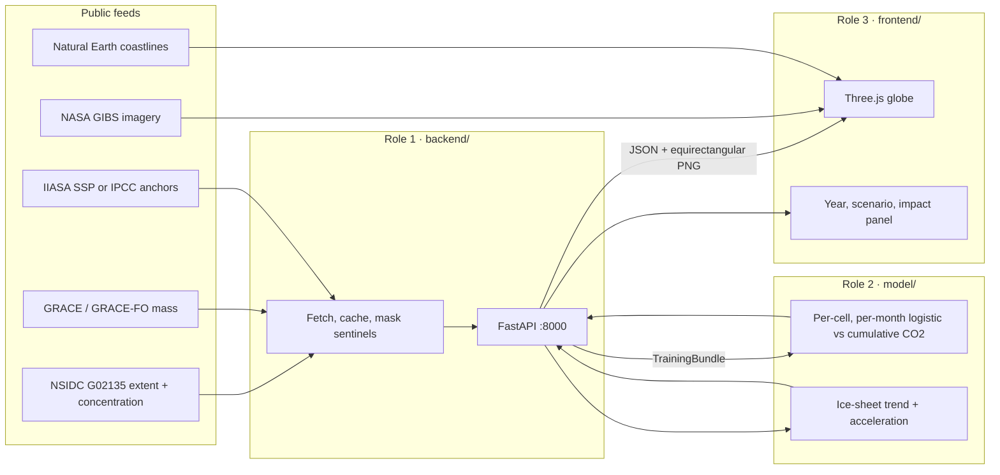

# Ice on Earth — 40-minute build plan

Berkeley × Stanford Grok Bot Hackathon, Track 3 (“Most Technically Complex”): make live public Earth-observation data useful to people on the ground.

A Three.js globe draws sea ice at both poles and the Greenland and Antarctic ice sheets. A year slider runs from 1979 through today to 2100. A second slider blends the IPCC scenarios SSP1-1.9, SSP1-2.6, SSP2-4.5, SSP3-7.0, and SSP5-8.5. Years inside the satellite record are observations. Later years are a forecast. An impact panel turns the grids into three things a person can use: how long the Northern Sea Route and the Northwest Passage stay open, when Arctic communities lose winter sea ice, and how many millimetres of sea level the two ice sheets have added.

This repository already contained `README.md` (a one-line title) and an MIT `LICENSE` (Copyright 2026 Joseph Lin). Both stay. This PR is the minute 0–5 setup and nothing else: no application code.

## Architecture



The browser talks only to our API for ice, extent, impact, and backtest. It may call NASA GIBS and Natural Earth directly for the photographic basemap and coastlines (both send `Access-Control-Allow-Origin: *`). The model module has no sockets; the backend hands it cleaned arrays.

## Roles

| Role | Branch | Writes only | Reads |
| --- | --- | --- | --- |
| 1. Data and API | `feat/backend` | `backend/` | `API.md`, `model/` (import only), `fixtures/` |
| 2. Forecast model | `feat/model` | `model/` | `API.md`, `fixtures/` |
| 3. Globe and impact UI | `feat/frontend` | `frontend/` | `API.md`, `fixtures/` (import, do not edit) |
| 4. Arctic ships | `feat/ships` | `ships/` | `API.md` (Task 4). North concentration only through the `install` hook |

Paste the matching file from `tasks/` into your assistant:

- `tasks/1-backend-data.md`
- `tasks/2-forecast-model.md`
- `tasks/3-frontend-globe.md`
- `tasks/4-ships.md`

`API.md` is the contract. If a brief and `API.md` disagree, `API.md` wins.

## Clock

| Minute | What happens |
| --- | --- |
| 0–5 | Done by this PR. Pull `main`, read this file and your brief, branch off `main`. |
| 5–20 | Build in parallel. Frontend uses `fixtures/`. Model uses synthetic arrays. Backend serves `/health` from the cache even when a fit is not ready. |
| 20 | Integration checkpoint. Push. Merge in the order below. `GET /health` returns JSON. One `GET /ice/north/{year}/9?format=png` returns an image or a stale cached image. The globe shows that image or a fixture banner, plus the impact panel. |
| 20–35 | Wire the real model into the backend. Point the frontend at `http://127.0.0.1:8000` with `VITE_USE_FIXTURES=false`. Fix only breaks on that path. |
| 35 | Code freeze. No new endpoints, files outside your folder, or dependency swaps. |
| 35–40 | One person fills the root `README.md` sections, records the video, and exports chat sessions. Nobody else commits. |

## Branch, folder, and merge rules

1. Branch from current `main` after this PR is merged (or from this branch only if `main` does not have it yet): `feat/backend`, `feat/model`, `feat/frontend`.
2. Commit only inside your folder. Do not reformat, restage, or “fix” anything else.
3. During the sprint nobody edits `README.md`, `PLAN.md`, `API.md`, `fixtures/`, `tasks/`, `LICENSE`, or `.gitignore`. Those files are shared. The only exception is the last five minutes, when a single person edits `README.md`.
4. A contract change is a checkpoint conversation, not a drive-by edit. Write the proposal at the bottom of your own README under `Contract change requests` and stop. One person applies an agreed edit to `API.md` after minute 20 if the demo is blocked.
5. Merge order, after each branch is pushed and rebased on `main`:
   1. `feat/model` — pure library, no server.
   2. `feat/backend` — imports `model` and serves the API.
   3. `feat/frontend` — static client; safe to merge last so the demo keeps one UI.
6. Folders do not overlap, so git conflicts mean someone left their folder. Revert that part of the commit. Do not resolve a conflict by rewriting another role’s files.
7. Cache, virtualenvs, `node_modules`, and `.env` stay untracked (see `.gitignore`). Earthdata usernames and passwords never go in git, in a fixture, or in a task file.

Suggested commands:

```bash
git checkout main
git pull
git checkout -b feat/backend   # or feat/model, feat/frontend
# work, then
git add backend                # your folder only
git commit -m "Serve ice API from cached NSIDC grids"
git push -u origin feat/backend
git fetch origin
git rebase origin/main
```

## Definition of done

The demo is done when all of these are true on one machine:

- The globe shows both poles and can be rotated. Greenland and Antarctica read as ice sheets (mass loss in the panel, not a made-up thickness map).
- The year slider spans 1979 through 2100, and a month control can select December 1987 and January 1988. Years through the latest real NSIDC month are marked observed. Later years are marked forecast.
- The scenario control has the five SSP stops and a position between them. Moving it changes a forecast year. It does not change an observed year.
- The impact panel shows, for the selected year and scenario: Northern Sea Route and Northwest Passage open-season length and opening date, the first year September Arctic extent falls under 1 million km², the winter sea-ice loss index, and sea-level millimetres from each ice sheet plus the total.
- `GET /health` lists every feed with `ok`, `stale`, or `down`. A killed network still returns HTTP 200 and the last good ice image, with `stale: true`.
- December 1987 and January 1988 do not draw a fake ice edge and do not throw. Extent is `null` and `gap_masked` is true.
- `GET /backtest` returns RMSE for a model trained on data through 2010 and scored on later observed months.
- The UI stays up when the API is down: it shows the fixture banner or an error state, and the sliders still move.
- Root `README.md` has every required section filled in well enough to submit. Fixtures are never presented as observations.

## Data sources

Checked on 2026-11-19. No application code in this PR downloads them; the URLs are here so Role 1 does not rediscover them.

### NSIDC Sea Ice Index G02135 v4 — no login

HTTPS directory listing, CSV and GeoTIFF.

- Daily extent, two header rows, extent in **10^6 km²**:
  - `https://noaadata.apps.nsidc.org/NOAA/G02135/north/daily/data/N_seaice_extent_daily_v4.0.csv`
  - `https://noaadata.apps.nsidc.org/NOAA/G02135/south/daily/data/S_seaice_extent_daily_v4.0.csv`
- There is **no** single `N_seaice_extent_monthly_v4.0.csv` (that URL 404s). Monthly extent is one file per calendar month, extent and area in **10^6 km²**:
  - `https://noaadata.apps.nsidc.org/NOAA/G02135/north/monthly/data/N_{MM}_extent_v4.0.csv`
  - `https://noaadata.apps.nsidc.org/NOAA/G02135/south/monthly/data/S_{MM}_extent_v4.0.csv`
  - Columns: `year, mo, source_dataset, region, extent, area`. Sentinel `-9999`.
- Monthly concentration GeoTIFF (uint16, divide by 10 to get percent):
  - `https://noaadata.apps.nsidc.org/NOAA/G02135/{north|south}/monthly/geotiff/{MM}_{Mon}/{N|S}_{YYYY}{MM}_concentration_v4.0.tif`
  - Month folders: `01_Jan` `02_Feb` `03_Mar` `04_Apr` `05_May` `06_Jun` `07_Jul` `08_Aug` `09_Sep` `10_Oct` `11_Nov` `12_Dec`.
- User guide: `https://nsidc.org/sites/default/files/documents/user-guide/g02135-v004-userguide.pdf`
- GeoTIFF class values (Table 5): `0–1000` concentration × 10, `2510` pole hole, `2530` coast, `2540` land, `2550` missing. Values under 15% are below the extent threshold.
- The user guide names the grid EPSG:3411 (north) and EPSG:3412 (south), nominal 25 km. Trust the CRS tag inside the file you download. Expect on the order of 304×448 (north) and 316×332 (south); read the size, do not hardcode it until the first file confirms it.
- Gap, verified against the v4 files: monthly `1987-12` and `1988-01` are `-9999`. Daily rows are absent from `1987-12-03` through `1988-01-12` inclusive; `1988-01-13` exists. SMMR days before 1987-08-20 are every other day; that is not the gap.

### NASA GIBS — no login, CORS open

Imagery for the globe texture. This is not the 1979–2100 data cube (the AMSR2 sea-ice layer starts in 2012).

- Whole-Earth WMS, verified HTTP 200, `Access-Control-Allow-Origin: *`:
  - Basemap JPEG: `https://gibs.earthdata.nasa.gov/wms/epsg4326/best/wms.cgi?SERVICE=WMS&REQUEST=GetMap&VERSION=1.3.0&LAYERS=MODIS_Terra_CorrectedReflectance_TrueColor&FORMAT=image/jpeg&WIDTH=1024&HEIGHT=512&CRS=EPSG:4326&BBOX=-90,-180,90,180&TIME=2024-09-15`
  - Recent sea ice PNG: same endpoint with `LAYERS=AMSRU2_Sea_Ice_Concentration_25km`, `FORMAT=image/png`, `TRANSPARENT=true`.
- WMTS template (geographic): `https://gibs.earthdata.nasa.gov/wmts/epsg4326/best/AMSRU2_Sea_Ice_Concentration_25km/default/{Time}/2km/{TileMatrix}/{TileRow}/{TileCol}.png`
- Capabilities fetched the same day advertise that AMSR2 layer’s time as `2012-07-02/2025-09-01/P1D`. Treat a lagging end date as `stale`, and keep the historical slider on NSIDC plus the model.

### GRACE / GRACE-FO ice-sheet mass — Earthdata login for the files

- Antarctica product page (HTTP 200): `https://podaac.jpl.nasa.gov/dataset/ANTARCTICA_MASS_TELLUS_MASCON_CRI_TIME_SERIES_RL06.3_V4` (DOI `10.5067/TEMSC-AT634`). ASCII time series inside a protected bucket.
- Greenland product page also HTTP 200 for `GREENLAND_MASS_TELLUS_MASCON_CRI_TIME_SERIES_RL06.3_V4`: `https://podaac.jpl.nasa.gov/dataset/GREENLAND_MASS_TELLUS_MASCON_CRI_TIME_SERIES_RL06.3_V4`. Confirm the short name in Earthdata search; older RL06 v2 pages have been marked deprecated.
- The old `climate.nasa.gov` text-file URLs redirect to an HTML page. They are not a CSV.
- `https://imbie.org/data-downloads/` returned 404. Do not depend on it.
- If nobody can log in during the hour, serve the NASA Science summary rates and label the source `nasa-science-summary-fallback`: about **264 Gt/yr** Greenland and about **135 Gt/yr** Antarctica. Page (wording varies between 264 and 266 in the same article; use 264 and 135): `https://science.nasa.gov/earth/explore/earth-indicators/ice-sheets/`.
- Convert mass to sea level at **362 Gt per mm**. Negative mass anomaly is positive sea level.

### SSP pathways — public site, flaky API, no password

- Scenario Explorer UI is up: `https://ssp.apps.ece.iiasa.ac.at/` (HTTP 200).
- `https://data.ece.iiasa.ac.at/ssp/` now says the application has migrated. Do not hardcode that old path.
- Preferred query is the marker scenario’s World `Emissions|CO2`, cumulated, via the current IIASA API or `pyam`. Marker models usually used with these ids: IMAGE (SSP1-1.9 and SSP1-2.6), MESSAGE-GLOBIOM (SSP2-4.5), AIM/CGE (SSP3-7.0), REMIND-MAGPIE (SSP5-8.5).
- If the query fails, drive the forecast with the IPCC AR6 WG1 best-estimate warming anchors and set `regressor` to `ipcc_ar6_warming_c_fallback`. Anchors are °C relative to 1850–1900, best estimate, Table SPM.1: 2081–2100 is 1.4, 1.8, 2.7, 3.6, 4.4 for SSP1-1.9 through SSP5-8.5. Near-term (2021–2040) best estimate is 1.5 °C on every pathway. Do not relabel that fallback as cumulative CO2.
- Historical cumulative CO2 should be the running sum of Global Carbon Budget annual fossil plus land-use emissions from 1850 (`https://globalcarbonbudget.org/`). The file is public. This scaffold did not re-download the spreadsheet.

### Natural Earth — no login

- Land, verified HTTP 200: `https://naciscdn.org/naturalearth/110m/physical/ne_110m_land.zip`
- Coastline, verified HTTP 200: `https://naciscdn.org/naturalearth/110m/physical/ne_110m_coastline.zip`
- The files are static (land zip last-modified 2021). Age is not staleness. A failed download with a cached zip is `stale`.

## Robustness the demo has to show

- Persist the last good bytes under `backend/cache/` and serve them when the upstream errors or times out (8 second limit per feed).
- `/health` never 500s because a feed is down.
- Mask the 1987–88 gap. Map `-9999`, `2510`, `2530`, `2540`, and `2550` before any math. Those numbers must not come out of the API as if they were ice.
- A missing grid is `extent_km2: null` and a transparent image, not a crash and not zero ice.
- Forecast uncertainty is a bootstrap band (`low` = 10th percentile, `median` = 50th, `high` = 90th), seeded and reproducible.

## What this PR deliberately leaves out

No FastAPI app, no model fit, no Three.js scene, no `package.json`, no `requirements.txt`. Each role adds those inside its own folder so the three assistants never edit the same file.
